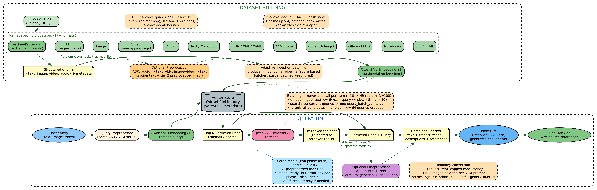

# Multimodal RAG

An **MCP server, REST API and web frontend that ingest documents, images, video and audio into one joint multimodal vector index and retrieve over them** — shipped as three Helm charts for HPE Private Cloud AI: `rag-mcp-server` 6.3.2 (single replica, the default), `rag-mcp-scale-medium` 6.3.2 and `rag-mcp-scale-large` 6.3.2.

<div align="center"></div>

## What it is

**RAG** (retrieval-augmented generation) means answering a question from documents you supply rather than from the model's training data: search a corpus for the passages that matter, put them in the prompt, generate. This package is the search-and-store half of that loop, plus the tool surface an LLM agent uses to drive it.

It is an **MCP server** — a Model Context Protocol endpoint, i.e. a standard way to expose tools to an LLM agent — with 25 tools (search, federated search, dataset and document management, long-term memory, short-term session datasets, media inspection). The same process group also serves a **REST API** (40 endpoints), an **HTML frontend**, and an **Open WebUI filter**.

The word *multimodal* is load-bearing: text, images, video and audio are embedded into **one vector space** by a single model (Qwen3-VL-Embedding-8B), so a screenshot can be found by a text query and a paragraph can be found by an image. Audio is the exception — it is transcribed to text before embedding, because the embedder has no audio tower.

A recorded walkthrough with chapters and subtitles (models, dataset ingestion, Open WebUI integration, the opencode long-term-memory implementation): [Video demonstration](https://storage.googleapis.com/ai-solution-engineering-videos/public/MultimodalRag.mkv).

The deployment is one pod with two containers (REST API + web UI on port 8000, MCP server on port 9090) sharing one ReadWriteMany PVC, plus a Qdrant vector-database StatefulSet. Both containers see the same Qdrant and the same `/data`, so a dataset uploaded in the browser is immediately searchable through MCP and vice versa.

## The problem it solves

- **Your corpus is not text.** Scanned PDFs with charts, screenshots, screen recordings, call audio. Most RAG stacks flatten all of that to text and lose the page. This one keeps a three-tier media schema (raw file, display copy, model-ready copy) and embeds the media itself, so the answer can return the frame that proves it.
- **You cannot search media with words, or text with pictures.** Captions are the usual workaround and they are lossy. Here every PDF gets a text-only *twin* and every image/video gets a caption twin, so the same document is reachable through both the pixel embedding and the words a human would use.
- **Dense similarity is weakest exactly where a technical corpus is densest** — error codes, function names, JSON keys, version strings. Every new collection therefore carries a BM25 sparse lane beside the dense vector, fused server-side with RRF in one Qdrant round-trip.
- **An agent that cannot remember repeats its mistakes.** The package is also the memory backend for opencode and Open WebUI: per-user long-term memory, plus **procedural** memory (a reusable playbook with an outcome inferred from trace signals, ranked by empirical success rate rather than by the model's opinion of itself).
- **"The retrieval got worse" is not measurable.** A deterministic, offline faithfulness scorer with a committed golden set runs inside the normal test suite, so a retrieval or prompt change that degrades grounding fails a test instead of shipping.
- **You cannot run `helm` on PCAI.** The charts are packaged for PCAI import; every site decision is a values key, and everything that cannot be a value is an explicit prerequisite — see [Prerequisites at a glance](#prerequisites-at-a-glance).

## How it fits in PCAI

| Layer | Component | This package's part |
|---|---|---|
| Ingress | Istio `ezaf-gateway` + oauth2-proxy | Renders the `VirtualService` and the oauth2-proxy `AuthorizationPolicy` — which authenticates **gateway** traffic only; a direct ClusterIP call bypasses it, and `networkPolicy` is what closes that path |
| Model serving | MLIS endpoints (embedder, reranker, VLM, ASR) | A **client** of them: `models.*.url` + `modelSecrets.*ApiKey`. The image bundles no model weights |
| Storage | RWX PVC + Qdrant StatefulSet | Owns both: `persistence.data` (files + metadata) and `persistence.qdrant` (vectors) |
| Identity | Keycloak / UA realm, the gateway's proxy headers | Optional OIDC **client** (D21/D22) resolving to the same per-user registry identity as an API key |
| Object store | MinIO / S3 | Optional: batch URL ingest, watched-source sync, scheduled backups |
| MCP fleet | Agents, the PCAI LLM gateway relay, opencode, Open WebUI | Provides the `rag` tool surface; consumed by them |

**Depends on:** a reachable embedder endpoint (the only required model — startup aborts without it), an RWX storage class, and a PCAI namespace. **Depended on by:** any agent or client configured against its MCP endpoint; in a fleet deployment the PCAI LLM gateway relay and the Open WebUI filter are the usual callers.

## Capabilities, by theme

Each line carries the design decision, because the decision is the feature. Depth — every format, every knob, every failure mode — is in [documentation/FEATURES.md](documentation/FEATURES.md).

### Ingestion and modality

- **17+ formats, one pipeline** — PDF (page-by-page with chart/figure extraction), images, video (overlapping segments), audio, text/markdown, JSON, XML, YAML, CSV/Excel, code (16 languages), HTML, Office, notebooks, EPUB, logs, archives. *Why:* a corpus is never one format, and per-format chunking beats one generic splitter — code splits on function boundaries, logs on timestamp/severity, tables one row per document. See [FEATURES.md § Format-by-Format](documentation/FEATURES.md#format-by-format-processing).
- **Three-tier media schema** — raw file, display copy (1920×1080 / 720p24), model-ready copy (720×720, base64 in the vector payload). *Why:* fidelity for the human, cheap bytes for the model; the reranker and VLM consume the tier-3 copy directly, so no per-query resizing. See [FEATURES.md § Three-Tier Media Schema](documentation/FEATURES.md#three-tier-media-schema).
- **Dual-embedding "twins"** — a text-only twin for PDFs, a caption twin for media. *Why:* one document must be reachable by both its pixels and its words; unsupported media degrades to caption-only rather than silently vanishing.
- **Token-count-aware chunking** — chunk by the unit the model actually bills and truncates on, with a character-based fallback when no tokenizer is bundled. *Why:* character chunking silently overflows the embedder's window on code and CJK text. See [FEATURES.md § Token-Based Chunking](documentation/FEATURES.md#token-based-chunking).
- **Dedup and content hashing** — cosine ≥ 0.995 at ingest, plus a per-dataset content-hash sidecar. *Why:* re-uploading a folder must not double the index.
- **S3/HTTP ingest and watched sources** — an opt-in reconciler CronJob keeps datasets in sync with bucket prefixes; unchanged objects are skipped on ETag+Size before any download. See [FEATURES.md § Ingestion Sources](documentation/FEATURES.md#ingestion-sources).

### Retrieval

- **Hybrid dense + BM25 with server-side RRF**, per-dataset lane weights. *Why:* lexical recall for identifiers, semantic recall for paraphrase, one round-trip, and rank-space weights that cannot be mistaken for score multipliers. See [FEATURES.md § Hybrid dense + BM25](documentation/FEATURES.md#hybrid-dense--bm25-rrf-fusion).
- **Cross-encoder reranking** (Qwen3-VL-Reranker-8B) with over-fetch and media-lite scoring. *Why:* precision at the top of the list, without shipping every candidate's base64 payload to the reranker. See [FEATURES.md § Reranker](documentation/FEATURES.md#reranker-separate-model-class).
- **Metadata filters applied before ranking** — file type, severity, source prefix, date range. *Why:* filtering after ranking throws away the result you wanted.
- **Contextual retrieval (opt-in per dataset)** — one small LLM call per chunk writes a document-level context line before embedding, with a cost preview. *Why:* an isolated chunk cannot say which document it came from. **Fail-open:** an LLM error stores the plain chunk. See [FEATURES.md § Contextual retrieval](documentation/FEATURES.md#contextual-retrieval-ingest-time-document-context).
- **Agentic iterative retrieval (opt-in)** — a bounded retrieve → judge → rewrite loop that **fails open**: a judge that raises, times out or returns junk stops the loop and returns what was already found. *Why:* a judge outage may cost latency, never availability. See [FEATURES.md § Agentic iterative retrieval](documentation/FEATURES.md#agentic-iterative-retrieval-opt-in).
- **Multi-vector late interaction (opt-in per dataset)** — real MaxSim over token matrices in a sidecar collection. *Why:* **fails closed** without a token-level embedder — no hashed-token or split-vector pretending, because a fake late-interaction score is worse than none. See [FEATURES.md § Late interaction](documentation/FEATURES.md#multi-vector-late-interaction-opt-in-per-dataset).

### Memory

- **Long-term memory** — a per-user, LLM-curated store behind `add_memory` / `search_memory`, with provenance metadata and supersede-in-place so a re-distilled session replaces its predecessor instead of appending. *Why:* memory that only ever grows degrades recall. See [MEMORY.md](documentation/MEMORY.md).
- **Procedural memory (playbooks)** — the distiller's optional fifth section captures a procedure with a task signature and an outcome **inferred from trace signals, never self-assessed**; `recall_playbooks` ranks by smoothed success rate and returns conflicting playbooks side by side. *Why:* a model grading its own session is the failure mode the feature exists to avoid. See [PLAYBOOK-MEMORY.md](documentation/PLAYBOOK-MEMORY.md).
- **Memory consolidation** — an on-demand, dry-run-by-default decay/importance/contradiction pass. *Why:* archive only what is below the floor **and** never accessed **and** not a protected kind; contradictions are report-only, because a wrong merge is unrecoverable. See [FEATURES.md § Memory lifecycle](documentation/FEATURES.md#long-term-memory-procedural-memory-and-the-memory-lifecycle).
- **Short-term memory** — a private, auto-expiring session dataset with a non-guessable name, passwordless so it stays reapable. *Why:* an agent swarm needs a scratchpad that cannot leak into the catalog. See [FEATURES.md § Short-Term Memory](documentation/FEATURES.md#short-term-memory-session-scoped-ephemeral-datasets-opt-in).

### Identity and access

- **Fail-closed by default (D20)** — with no key configured anywhere, an anonymous caller reaches only the deployment's memory dataset. *Why:* a deployment that forgets its key must not run open. See [FEATURES.md § Security](documentation/FEATURES.md#security).
- **Per-user keys → dataset ACLs with read/write modes (D15/D26)** — `name:key` keys, per-dataset grants, and an `ro` mode so read access never travels with write access. *Why:* handing a colleague read access to a dataset should not hand them ingest and delete.
- **SSO as one more credential envelope (D21/D22/D24/D25)** — a verified JWT, an OIDC session cookie, or an enforcing proxy's identity header resolves through the **same** fail-closed registry lookup as an API key; the app is an OIDC **client**, never a proxy, so SSO creates no second identity path and no privilege shortcut. Self-mint (D25) lets an SSO user mint a key for their **own** identity only. See [FEATURES.md § Security](documentation/FEATURES.md#security).
- **Identity-gated frontend (D23)** — one shell, five tabs, every listing filtered by who you are; creator-owned delete and creator publish-global. See [FEATURES.md § Security](documentation/FEATURES.md#security).

### Evaluation and observability

- **CI-gated faithfulness eval** — a deterministic offline scorer (content-token coverage, numeric-contradiction and negation guards) with a committed golden set; the gate fails on a per-case regression, a mean below 0.80, or any growth in unsupported claims. *Why:* a lexical score without a numeric guard once rated a contradictory answer 1.0. See [FAITHFULNESS-EVAL.md](documentation/FAITHFULNESS-EVAL.md).
- **Prometheus metrics, health endpoints, and a report-only capability probe** — `/metrics`, `/healthz` / `/readyz` (deliberately not gated on the remote embedder: a model outage is not fixed by restarting the pod), and `memory_status` for automated memory writers. See [FEATURES.md § Observability](documentation/FEATURES.md#observability-prometheus-metrics).

### Operations and clients

- **Three chart sizes** — the decision is in [Which chart](#which-chart) below.
- **Scheduled backups, watched-source sync, STM reaper** — each CronJob carries a Qdrant readiness gate and a pod that stays readable after failure.
- **PodDisruptionBudgets and optional image digests** — a node drain cannot evict the whole serving tier or a Qdrant quorum.
- **25 MCP tools / 40 REST endpoints / an HTML frontend / an Open WebUI filter** — see [MCP.md](documentation/MCP.md), [API.md](documentation/API.md), [openwebui_extension/README.md](openwebui_extension/README.md).

## Which chart

The three charts share the same templates and the same values surface for everything site-specific (models, security, S3, identity, backups). They differ in replica counts, worker model, Qdrant topology and PVC layout — and **you pick one at import time, not later**: the Qdrant StatefulSet's volume-claim template is immutable, so moving between chart sizes means deleting the StatefulSet and re-indexing the vectors.

| | `helm/` (base) | `helm-scale-medium/` | `helm-scale-large/` |
|---|---|---|---|
| API replicas / workers | 1 × uvicorn | 2 × gunicorn (2 workers) | 4 × gunicorn (4 workers) |
| Qdrant | 1 instance (HTTP) | 2-node cluster (gRPC, sharded) | 3-node cluster (gRPC, sharded) |
| Unlock cache | in-process dict | Redis, cross-pod | Redis, cross-pod |
| Embed-batcher singleton | — | — | yes |
| Default request footprint | 20 Gi / 8 cpu | 24 Gi / 8 cpu | 45 Gi / 20 cpu |

**Choose the base chart** for a single team, a pilot, or any deployment where one replica is enough — it is the simplest thing that works and needs no Redis. **Choose medium** to run the scale architecture (workers, sharded Qdrant, cross-pod unlock) on a cluster sized for the base chart. **Choose large** for many concurrent users or a corpus that needs three Qdrant nodes. The measured comparison, the resource arithmetic and the per-chart benchmarks are in [SCALE.md](documentation/SCALE.md#summary-table).

## Deploy on PCAI (one screen)

Deployment is a **values** problem: the chart is packaged and imported into PCAI once, and the operator's only surface afterwards is the chart's values in the PCAI *Helm Values* editor.

1. **Create the platform Secret** you own, carrying both keys the containers refuse to start without (see [Prerequisites](#prerequisites-at-a-glance)).
2. **Import** the packaged chart for the size you chose (`rag-mcp-server-6.3.2.tar.gz`, `rag-mcp-scale-medium-6.3.2.tar.gz` or `rag-mcp-scale-large-6.3.2.tar.gz`) into PCAI AI Essentials.
3. **Paste and edit the values**: pick a profile from `helm/values-examples/`, set `models.embedder.url` and the model API keys, set `ezua.virtualService.endpoint`, point `security.existingSecret` at the Secret from step 1.
4. **Apply.** PCAI substitutes the domain placeholder, creates the namespace objects, and installs the release.
5. **Verify**: the release reaches Ready, `/healthz` answers `{"status":"ok"}`, and the VirtualService endpoint serves the UI behind the gateway's auth.

Full procedure, failure modes and the ordered SSO enablement: **[documentation/DEPLOYMENT.md](documentation/DEPLOYMENT.md)**.

## Prerequisites at a glance

Everything here is either a Secret you create or a cluster object that must already exist. None of it can be a chart value; all of it is a hard failure if missing. Failure modes, verification commands and the full tables are in [DEPLOYMENT.md § Prerequisites](documentation/DEPLOYMENT.md#2-prerequisites).

**Secrets**

| Secret | Keys | Required? | If missing |
|---|---|---|---|
| `security.existingSecret` (e.g. `rag-platform-keys`) | `RAG_API_KEY`, `MEDIA_TOKEN_SECRET` | recommended; otherwise the chart auto-generates into `<deployment.name>-model-keys` | no media secret → **both containers refuse to start** |
| `modelSecrets.existingSecret` (optional) | `MODEL_<ROLE>_API_KEY`, `MODEL_<ROLE>_URL`, `S3_*`, `REDIS_PASSWORD` | optional (values seeds are the alternative) | missing Secret = `CreateContainerConfigError` |
| `mcp.apiKey.existingSecret` | `api-keys` (comma-separated) | optional — without it MCP runs open | no MCP auth (REST-side fail-closed still applies) |
| `backups.protectedPasswords.existingSecret` | dataset name → password | only if backing up password-protected datasets | those datasets are skipped with a `SKIP-PROTECTED` log line |

**Cluster objects and platform dependencies**

| Object | Why it must exist | If missing |
|---|---|---|
| Namespace + RWX StorageClass (`gl4f-filesystem` default) | the shared `/data` PVC and the Qdrant claims | PVCs stay `Pending` |
| Istio gateway `istio-system/ezaf-gateway` | the rendered `VirtualService` attaches to it | endpoint unreachable |
| oauth2-proxy provider (or platform SSO at the edge) | the rendered `AuthorizationPolicy` names it | `AuthorizationPolicy` ineffective; 401/302 behaviour wrong |
| Kyverno (EzAF) | the pre-install hook creates the `hpe-ezua` vendor-label ClusterPolicy the catalog discovers services by | app card shows Unknown / 404 at the endpoint |
| MinIO/S3 bucket | only for batch URL ingest, watched sources or backups — buckets are **not** auto-created | ingest/backup job fails on the missing bucket |

**External dependencies.** Model endpoints must be reachable **from the pod**, not from your laptop — the embedder is probed at startup and an unreachable one aborts it. Reachability checks run from a cluster pod; see [DEPLOYMENT.md § External dependencies](documentation/DEPLOYMENT.md#23-external-dependencies).

## Day-2

- **Upgrade** — edit values and re-apply, or import the new chart version and keep the values. REST/media keys are reused across upgrades; model/S3/Redis keys are **sticky** (the stored value wins, values only seed). See [DEPLOYMENT.md § Upgrade](documentation/DEPLOYMENT.md#6-upgrade-rollback-uninstall).
- **Health** — `/healthz`, `/readyz`, `/api/admin/health` (model endpoints, Qdrant status, PVC), `/metrics`.
- **Logs** — `kubectl logs -l app=rag-mcp-server -c rag-api-server` (or `-c rag-mcp-server`) from the PCAI workload view.
- **Uninstall** — delete the release in PCAI. The data PVC is annotated `helm.sh/resource-policy: keep` and survives; Qdrant PVCs do not.
- **Troubleshooting** — symptom → cause → fix table in [DEPLOYMENT.md § Troubleshooting](documentation/DEPLOYMENT.md#7-troubleshooting).

## Documentation map

| File | The question it answers |
|---|---|
| [documentation/FEATURES.md](documentation/FEATURES.md) | What does each capability do, and why is it built that way? Every format, chunking strategy, retrieval lane, memory kind. |
| [documentation/DEPLOYMENT.md](documentation/DEPLOYMENT.md) | How do I deploy, upgrade and fix it on PCAI? The deployment contract, prerequisites, values, troubleshooting. |
| [documentation/CONFIGURATION.md](documentation/CONFIGURATION.md) | What is this knob, what is its default, and what does changing it do? The complete environment/values reference. |
| [documentation/MCP.md](documentation/MCP.md) | How do I connect an MCP client, and what do the 25 tools do? |
| [documentation/API.md](documentation/API.md) | How do I drive it over REST? Endpoint reference with `curl` and Python. |
| [documentation/MEMORY.md](documentation/MEMORY.md) | How does long-term memory work, and how do I set it up per client? |
| [documentation/PLAYBOOK-MEMORY.md](documentation/PLAYBOOK-MEMORY.md) | How does procedural memory work end to end? |
| [documentation/SCALE.md](documentation/SCALE.md) | Which chart size, and what does each scaling layer cost? |
| [documentation/FAITHFULNESS-EVAL.md](documentation/FAITHFULNESS-EVAL.md) | How is answer grounding measured and gated? |
| [documentation/VERIFICATION.md](documentation/VERIFICATION.md) | How do I prove a deployment actually works? |
| [documentation/BENCHMARKS.md](documentation/BENCHMARKS.md) | What throughput and latency has this been measured at? |
| [documentation/ROADMAP.md](documentation/ROADMAP.md) | What is deliberately not built yet? |
| [documentation/AGENTS.md](documentation/AGENTS.md) | What memory behaviour should an agent adopt? |
| [documentation/DEVELOPMENT_NOTES.md](documentation/DEVELOPMENT_NOTES.md) | Model validation, pipeline debugging, why a design was chosen. |
| [documentation/AUDIT-2026-11-10.md](documentation/AUDIT-2026-11-10.md) | What did the last audit find? (history, not current truth) |
| [helm/ROTATION.md](helm/ROTATION.md) | How do I rotate a key without breaking signed media URLs? |
| [helm/local/README.md](helm/local/README.md) | Where do real site values live, and what must never be committed? |
| [helm/values-examples/README.md](helm/values-examples/README.md) | Which paste-ready profile do I start from? |
| [openwebui_extension/README.md](openwebui_extension/README.md) | How does the Open WebUI filter route media and memory? |
| [stmem/README.md](stmem/README.md) | What is the short-term-memory service contract for agent swarms? |

## Developing locally

**This is not the deployment path.** PCAI operators never run these commands; they exist for changing the package.

```bash
python -m pytest tests/ -x -q          # the suite, including the faithfulness gate
ruff check . && ruff format --check .  # lint (never run the formatter without a path)
docker build -f docker/Dockerfile -t multimodal-rag-mcp:dev .   # image, repo root as context
helm template rag . -f helm/values-examples/values.hosted-trial.yaml  # render check, no install
```

The image bundles no model weights — a local run still needs the model endpoints from values. Local Qdrant is supported (`qdrant_storage/`), and a dev checkout without the bundled tokenizer falls back to character chunking. Per-site real values live in `helm*/local/` (gitignored, never packaged); see [helm/local/README.md](helm/local/README.md). Design history and validation notes: [documentation/DEVELOPMENT_NOTES.md](documentation/DEVELOPMENT_NOTES.md).
