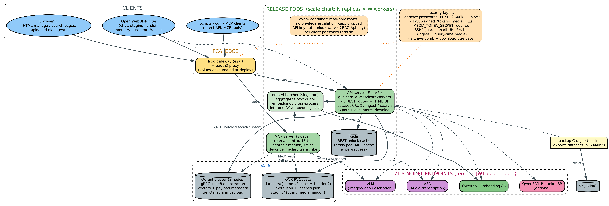

# Deployment Guide

Deployment on PCAI is a **values** problem. The chart is packaged and imported into PCAI once; from then on the operator's only surface is the chart's values in the PCAI *Helm Values* editor. This guide states that contract, then the prerequisites that cannot be values (Secrets and cluster objects), then the values themselves, then import, upgrade and troubleshooting.

<div align="center"> Istio gateway/oauth2-proxy -> API server + MCP sidecar + embed-batcher + Redis -> Qdrant cluster + PVC -> MLIS model endpoints, with security layers annotated"></div>

> **Section map for older references.** The chart's `values.yaml` header comments and the example values files predate this restructure and cite section numbers: `§2` is now **§3 (Values)**, `§5b` is now **§3.5 (the identity stack)** and **§3.9 (deployment profiles)**, and `§7b` is now **§3.8 (S3, backups and watched sources)**. Everything they describe is unchanged.

## 1. The deployment contract

1. **The chart is packaged and imported into PCAI once.** The deliverable is a chart tarball — `rag-mcp-server-6.3.2.tar.gz`, `rag-mcp-scale-medium-6.3.2.tar.gz` or `rag-mcp-scale-large-6.3.2.tar.gz` — imported through AI Essentials / an `EzAppConfig`. PCAI uploads it to ChartMuseum and its own controller installs it. You do not run `helm install`.
2. **The operator's only surface is the values editor.** Every site-specific decision must be a value: model endpoints, key Secret names, PVC sizes, identity posture, ingress endpoint, S3 wiring. No template edits, no post-render patching, no editing rendered manifests — an edited object is reverted by the next apply.
3. **What PCAI does for you.** It substitutes the domain placeholder in submitted values (the deployed release stores the resolved endpoint), renders the Istio `VirtualService` and the `ezua` block, creates the namespace, and applies the platform's admission policies.
4. **What you must do out-of-band**, because it cannot be a value: create the **Secrets** (§2.1) and make sure the **cluster objects** the chart attaches to exist (§2.2).
5. **Upgrade = import the new chart version, keep the values, re-apply** (§6). Rollback = re-apply the previous chart version with the same values.
6. **`/healthz` is not the acceptance test.** The release can be Ready while media URLs are wrong, the network zone silently denies Prometheus, or the SSO stack is half-enabled. §5 lists what to check.

**Secondary path, for developers only.** `helm template` / `helm upgrade` from a checkout is how the charts are validated, not how they are deployed. It has one trap the PCAI path does not: a raw `helm upgrade -f helm/values-examples/values.g2.yaml` passes the literal domain placeholder through, the Istio validation webhook denies the `VirtualService` (invalid host), and the release marks `failed` after earlier objects have already applied. Resolve the placeholder first (`sed "s/.../<site-domain>/g" values.g2.yaml > values.resolved.yaml`). The plain-Helm equivalents are collected in §6.1.

## 2. Prerequisites

Ordered by what blocks an install soonest. Everything in this section is **outside** the chart: if it is missing, no values edit fixes it.

### 2.1 Secrets the operator creates

The chart ships **no key material** (P0-7). It creates exactly one Secret of its own — `<deployment.name>-model-keys` (default `rag-mcp-server-model-keys`) — and that Secret holds both the REST keys and the seeded model/S3/Redis keys. Everything else is a Secret **you** own and reference by name.

| Secret | Keys | Consumed by | Why it exists | Fails how without it | Create with |
|---|---|---|---|---|---|
| `security.existingSecret` (recommended; example name `rag-platform-keys`) | `RAG_API_KEY`, `MEDIA_TOKEN_SECRET` (key names configurable via `security.existingSecretApiKey` / `security.existingSecretMediaTokenKey`) | both containers, via `secretKeyRef` | the REST API key and the HMAC secret that signs short-lived media URLs | **no `MEDIA_TOKEN_SECRET` → both containers refuse to start** (the legacy clear `?password=` media URLs were removed, so the secret is not optional); no API key → the D20 fail-closed posture (anonymous callers reach only the memory dataset) | `kubectl -n <ns> create secret generic rag-platform-keys --from-literal=RAG_API_KEY="$(openssl rand -hex 16)" --from-literal=MEDIA_TOKEN_SECRET="$(openssl rand -hex 32)"` |
| `<deployment.name>-model-keys` | `MODEL_EMBEDDER_API_KEY`, `MODEL_RERANKER_API_KEY`, `MODEL_VLM_API_KEY`, `MODEL_ASR_API_KEY`, `S3_ACCESS_KEY_ID`, `S3_SECRET_ACCESS_KEY`, `REDIS_PASSWORD`, plus the REST keys above | API + MCP containers, embed-batcher, all CronJobs (`envFrom` + mounted at `/etc/rag/secrets`) | the chart-managed store for every deployment credential | created **by the chart** — do not create it yourself, and **never delete it**: the REST keys and the sticky state live there | chart-managed; seeded from `modelSecrets.*ApiKey` / `s3.*` / `redis.password` on first install |
| `modelSecrets.existingSecret` (optional, recommended for key-material hygiene) | the canonical names above, optionally `MODEL_<ROLE>_URL` endpoint overrides | same as above — wired **last** in `envFrom` and in `CONFIG_DIR`, so every key it carries wins | keeps key material out of values entirely | the Secret is hard-wired: a **missing** Secret name (typo, wrong namespace) = `CreateContainerConfigError` on every workload | build from `helm/local/secrets.template.yaml`, then `kubectl apply -n <ns> -f secrets.<site>.yaml` |
| `mcp.apiKey.existingSecret` (optional) | one key, name from `mcp.apiKey.existingSecretKey` (default `api-keys`) holding a comma-separated list | the MCP container | gates every `/mcp` request on `X-API-Key` / Bearer | **unset → MCP runs open** with a loud startup warning (the REST-side D20 fail-closed still applies) | `kubectl -n <ns> create secret generic mcp-fleet-apikeys --from-literal='api-keys=<key1>,<key2>'` |
| `backups.protectedPasswords.existingSecret` (optional) | one key per dataset **name**, value = that dataset's password | the backup CronJob (mounted read-only) | lets scheduled backups export password-protected datasets | those datasets are **skipped** with a loud `SKIP-PROTECTED` log line naming the missing key; the rest of the backup succeeds | `kubectl -n <ns> create secret generic rag-dataset-passwords --from-literal=<dataset-name>=<password>` |
| `metrics.serviceMonitorBearerSecret` (optional) | a key holding a valid API key (default `RAG_API_KEY`) | the rendered ServiceMonitor | lets Prometheus scrape a deployment with `security.metricsAuth: true` | the scrape 401s and targets go down | create the Secret, then set the value |

Two rules that decide most of the pain:

- **Precedence, REST keys:** `security.existingSecret` > inline `security.apiKey` / `mediaTokenSecret` > the stored release value > **fresh auto-generation on first install**. So the common case needs no pre-created Secret at all — but a GitOps/offline render does (see §3.10).
- **Precedence, model/S3/Redis keys: sticky in the opposite direction** — the value already stored in `<deployment.name>-model-keys` WINS on every upgrade and the values entries are only the **seed**. A values edit to an already-seeded key is inert; delete the Secret to reseed, or rotate out-of-band. Rotation runbook: `helm/ROTATION.md`.

### 2.2 Patches and cluster objects

These are the things that are not values. The first four are rendered by the chart but **attach to platform objects you must already have**; the rest are objects you create.

| Object | Why it is required | What breaks without it | Verify |
|---|---|---|---|
| Namespace + an RWX StorageClass (default `gl4f-filesystem`) | the data PVC is mounted **concurrently** by several consumers, which is why the claim must be `ReadWriteMany`: the root init container (`fix-pvc-permissions`, which chowns the tree), the `rag-api-server` and `rag-mcp-server` containers in the same pod, and — on the scale charts — every API replica (2 or 4 pods) mounts the same claim. **No CronJob mounts it**: the backup and watched-source jobs reach datasets through the REST API. The Qdrant claims come from the same class (RWO per replica on the scale charts) | PVCs stay `Pending` and every pod stays unschedulable — the release never reaches Ready | `kubectl -n <ns> get pvc` → all `Bound` |
| Istio gateway `istio-system/ezaf-gateway` | the rendered `VirtualService` binds to it; `ezua.virtualService.istioGateway` names it | render fails while `ezua.enabled` and the endpoint is unset; with a wrong gateway name the route is never programmed and the endpoint 404s | `kubectl -n <ns> get virtualservice` shows the host; open the endpoint |
| oauth2-proxy provider (`oauth2-proxy` in `istio-system`, or the platform's equivalent) | the rendered `AuthorizationPolicy` (`ezua.authorizationPolicy.enabled`, default `true` — **on in both shipped site profiles, G2 included**) names that provider. It selects only the ingressgateway pods, so it protects the gateway path and **not** a direct ClusterIP call | the policy is ineffective: no 401/redirect at the gateway, so the app is reachable unauthenticated through the ingress (and the D21 token assertion becomes the only boundary — see §3.5) | unauthenticated browser request to the endpoint must redirect or 401, not render the app |
| Kyverno (EzAF admission) | a **pre-install hook** creates a `ClusterPolicy` that labels Deployments and Services in the release namespace with `hpe-ezua/type: vendor-service` and `hpe-ezua/app: rag-mcp-server` | the EZUA ingress does not discover the service → **404 at the VirtualService endpoint**, and the app-catalog card shows **Unknown** (catalog status is derived from labeled **pods**) | `kubectl -n <ns> get deploy,svc --show-labels | grep vendor-service` |
| `networkPolicy` (opt-in; the template and the values surface are **identical in all three charts**) | the ingress allowlist; once enabled, anything unmatched is **denied** | an unlisted in-cluster caller times out (deny by absence); an unlisted Prometheus scrape namespace dies **silently** | from an allowed namespace: HTTP 200 on `service:port/mcp`; from any other: timeout |
| `backups.bucket` (a bare bucket name) | the backup CronJob uploads there; MinIO/S3 does **not** auto-create buckets | the backup run fails until the next tick, every tick | create it once from a running pod (the pod already carries the credentials); see §3.8 |
| S3 prefixes / buckets for batch ingest | `watchedSources.sources[].prefixes` must be existing `s3://` directory URLs | the CronJob logs a per-source failure (the run is fail-soft, one bad source does not kill the others) | `kubectl -n <ns> create job --from=cronjob/<release>-watched-sources <name>` and read the log |
| The LLM-gateway relay namespace (only with the network zone on) | every unlisted namespace is denied | the gateway's MCP calls time out — **list it first** when you build the allowlist | relay tool call returns, not 504 |

**Turning the network zone on.** The template is byte-identical in all three charts (same file, same values surface), so this procedure is the same at every chart size — the only per-chart difference is which callers you must list, since the scale charts add Redis and the embed-batcher in the release namespace (covered by `sameNamespace`). Six steps:

1. `kubectl get ns` to find the namespaces that must reach the service.
2. Append them to `networkPolicy.authorizedClients.namespaces`. **Keep the Prometheus scrape namespace in the list** — an unlisted scrape namespace dies silently, so check the target list after enabling.
3. Put your cluster's pod CIDR into `networkPolicy.probeExceptCidrs` (or real node IPs into `probeCidrs`) so kubelet probes and port-forward still work. The render **fails** on `0.0.0.0/0` with an empty exception list.
4. Leave `ezua.virtualService.enabled: true` — the browser path through the edge gateway is a feature of this posture, not a break-glass.
5. Apply through the values editor.
6. Verify from both sides: an allowed namespace gets HTTP 200 from `service:port/mcp`, any other times out, browsers still reach the UI through the gateway.

The full hardened profile is `helm/values-examples/values-hardened-g2.yaml` (an **overlay** to merge into a profile file, not a standalone values document). Note the edge-pod label trap it documents: edge pods carry `app: istio-ingressgateway` — `ezaf-gateway` is the Gateway CR name, not a pod label. Do not "fix" that back.

### 2.3 External dependencies

Prove reachability **from inside the cluster**, not from your laptop — the pod's network position, DNS and egress policy are what matter.

| Dependency | Required? | Prove it from the cluster | Failure mode if wrong |
|---|---|---|---|
| Embedder endpoint (`models.embedder.url` or `MODEL_EMBEDDER_URL`) | **required** | `kubectl -n <ns> exec deploy/<deployment.name> -- python -c "import os,httpx;print(httpx.get(os.environ['MODEL_EMBEDDER_URL'].rstrip('/')+'/v1/models', timeout=10).status_code)"` | startup aborts (missing URL) or the `/v1/models` probe 401s and the pod **CrashLoopBackOffs** |
| Reranker / VLM / ASR | optional | same probe against their URLs | a warning at startup, the feature degrades (no rerank / no caption / no transcript) — never a crash |
| Qdrant | bundled | `/readyz` on the app; `kubectl -n <ns> get sts` | the pod starts but every dataset call fails |
| S3 / MinIO | only for URL ingest, watched sources, backups | `kubectl -n <ns> exec deploy/<deployment.name> -- python -c "import boto3,os;print(boto3.client('s3',endpoint_url=os.environ['S3_ENDPOINT_URL']).list_buckets())"` | ingest/backup fails per object; the error names the endpoint |
| Keycloak / UA realm (only with D21/D22) | optional | `kubectl -n <ns> exec deploy/<deployment.name> -- python -c "import os,httpx;print(httpx.get(os.environ['OIDC_JWKS_URL'],timeout=5).status_code)"` | JWT verification fails 401; the app logs a loud startup warning when the issuer is unset |
| An HTTP(S) proxy, if model traffic must traverse one | site-specific | the same probes **with** the proxy envs set via `extraEnv` | the probes hang; note that the SSRF DNS-rebinding pin is skipped when a proxy performs egress DNS |

### 2.4 The model-keys Secret is not the platform Secret

Two different objects, easily confused:

- `<deployment.name>-model-keys` — created **by the chart**, holds the REST keys plus the seeded model/S3/Redis keys. Retrieve the API key from it; never delete it.
- `security.existingSecret` / `modelSecrets.existingSecret` — created **by you**, referenced by name. If one is named but absent, the pods fail loudly (`CreateContainerConfigError`), which is the intended behaviour: a silent fallback to an insecure default would be worse.

## 3. Values

All configuration lives in the chart's values. This section is the shape of the file and the reasoning per group; the complete knob-by-knob reference (defaults, env var names, what changing each one does) is [CONFIGURATION.md](CONFIGURATION.md).

### 3.1 Required values

Four values decide whether the release works at all:

| Value | Why | Failure if wrong |
|---|---|---|
| `models.embedder.url` | the only truly required model — every ingest and every text search goes through it | startup aborts (no URL) or `/v1/models` 401 → CrashLoopBackOff |
| `security.existingSecret` (or inline keys) | see §2.1 | no media secret → containers refuse to start |
| `ezua.virtualService.endpoint` | the route host, and the source of `MEDIA_BASE_URL` | **render fails** while `ezua.enabled`; an empty `MEDIA_BASE_URL` makes MCP media URLs relative paths a chat client cannot render |
| `persistence.data.size` / `persistence.qdrant.size` | sized to the corpus; the Qdrant claim is **immutable** after install | resizing later means deleting the StatefulSet and re-indexing |

### 3.2 Models

Each model role has the same shape — `name`, `url`, `className`, optional `extra` kwargs. An empty `url` disables that role at startup (a warning, not a crash).

```yaml
models:
  embedder:                       # REQUIRED
    name: RamManavalan/Qwen3-VL-Embedding-8B-FP8
    url: "https://<embedder-endpoint>"
    className: MultiModalEmbeddings
    extra:
      embedding_dim: 4096
      chunk_size: 2048            # tokens per chunk (text)
      chunk_overlap: 256
      code_chunk_size: 8192       # structured types: code/json/xml/yaml
      code_chunk_overlap: 512
      tokenizer_name: Qwen/Qwen3-VL-Embedding-8B
      tokenizer_type: HuggingFace
      alias: Qwen/Qwen3-VL-Embedding-8B   # fingerprint alias so datasets indexed under the old id survive an FP8 swap
  reranker:                       # optional
    name: Qwen/Qwen3-VL-Reranker-8B
    url: "https://<reranker-endpoint>"
    className: MultiModalReranker
  vlm:                            # optional — also drives captions and contextual retrieval
    name: Qwen/Qwen3.8-27B-FP8
    url: "https://<vlm-endpoint>"
  asr:                            # optional — audio transcription
    name: CohereLabs/cohere-transcribe-03-2026
    url: "https://<asr-endpoint>"
```

The image bundles **no model weights** — every role is a remote OpenAI-compatible endpoint. `rag.remote` switches between in-cluster service DNS (`.svc.cluster.local`) and external URLs; remote mode disables TLS verification unless `REMOTE_CA_BUNDLE` pins a CA bundle.

Model API keys are **not** here — they go in the Secret (§2.1), either seeded from `modelSecrets.*ApiKey` or supplied wholesale through `modelSecrets.existingSecret`.

### 3.3 Storage

```yaml
persistence:
  data:
    size: 200Gi                    # uploaded files + dataset metadata + access/ and staging/
    storageClass: gl4f-filesystem  # must be RWX-capable
    accessMode: ReadWriteMany      # RWO breaks the multi-container / multi-pod share
  qdrant:
    size: 150Gi
    storageClass: gl4f-filesystem
    accessMode: ReadWriteMany      # volumeClaimTemplate mode (scale charts: ReadWriteOnce per replica)
    mountReadOnly: true            # API/MCP pods mount it read-only for /api/admin/health disk reporting
```

The data PVC is annotated `helm.sh/resource-policy: keep` and survives uninstall. The Qdrant PVCs are created from the StatefulSet's `volumeClaimTemplates` and do **not** survive; on the large chart they are additionally retained on scale-down (`persistentVolumeClaimRetentionPolicy: Retain`), so deleting a Qdrant PVC is an explicit action. **Both Qdrant claim fields are immutable** — see §6.

### 3.4 Security knobs

All of these render into the ConfigMap as hardening env vars; defaults are in `helm/values.yaml`.

| Key | Default | Effect |
|---|---|---|
| `security.mediaTokenTtl` | `3600` | Lifetime (seconds) of the HMAC token on a returned media URL |
| `security.maxDownloadBytes` | `536870912` (512 MiB) | Per remote/S3 download cap — the stream is aborted past it (SSRF blast-radius guard) |
| `security.archiveMaxTotalBytes` / `archiveMaxMemberBytes` / `archiveMaxEntries` | 2 GiB / 1 GiB / 10000 | Zip/tar/rar unpacked-size and entry caps, nested archives included (zip-bomb guard) |
| `security.mediaAllowPathPrefixes` | `/data/datasets:/data/staging` | The `file://` prefixes the MCP `inspect_media` / audio-query tools may read; fail-closed when unset |
| `security.blockPrivateHosts` | `true` | Reject http(s) URLs that resolve to private/link-local ranges — for ingest **and** query-time media. Every fetch connects to the IP the policy validated (DNS-rebinding pin) |
| `security.ingestAllowHosts` | `''` | Comma-separated host allowlist for http(s) ingest. **Interacts with `MEDIA_BASE_URL`** — see below |
| `security.pwMaxFailures` / `pwFailWindow` | `10` / `300` | Password-failure throttle per identity (429), REST and MCP unlock alike |
| `security.trustProxyIdentity` | `false` (charts ship it, site examples set `true`) | **D24** — accept the auth proxy's identity headers as a presented credential (one of the D25 mint sources). Set `true` **only** behind an enforcing proxy that overwrites them on every request; a direct caller could otherwise spoof the header, and with D25 on a spoofed identity could mint keys |
| `security.enforcingProxySignal` | `''` | **P0-1 proof material.** When set, proxy-identity requests must also carry `X-Enforcing-Proxy` with exactly this value. Unwired proxy = the feature is lost, never silently trusted |
| `security.metricsAuth` | `false` | Require an API key on `/metrics`; pair with `metrics.serviceMonitorBearerSecret` |
| `security.requirePinnedKeys` | `false` | **GitOps guard** — fail the render when neither a stored value nor a values key provides `RAG_API_KEY` / `MEDIA_TOKEN_SECRET`. See §3.10 |
| `rag.ocr` | `false` | OCR fallback for scanned PDFs (a per-dataset flag still wins) |
| `rag.captionWithVlm` / `captionWithAsr` | `true` | Caption/transcribe at ingest; auto-disables when that model role is not configured |
| `rag.dedupThreshold` | `0.995` | Cosine similarity above which an ingest candidate is dropped as a near-duplicate |
| `rag.rrfDefault` | `enabled: false` | Stamps a per-dataset weighted-RRF default into **new** datasets (`RAG_RRF_DEFAULT`, `dense,sparse[,k]`). Rank-space tilt — trust the order, not the magnitude. Existing datasets untouched; an explicit `rrf` object in the create body always wins |
| `rag.contextual` | `false` | Stamps `contextual: true` into **new** datasets (one small LLM call per text chunk). Off by default; a disabled deployment renders no config key |
| `rag.unlockMaxTtl` | `86400` | Cap for explicit unlock TTLs on both surfaces; `0` opts into no-expiry unlocks |
| `rag.prefetchFloor` | `200` | Per-lane Qdrant prefetch floor for hybrid search; clamped at 1000 |

**`security.ingestAllowHosts` and `MEDIA_BASE_URL` interact — list your own host.** Since the 2026-11-10 audit remediation the allowlist is authoritative for *media* URLs too (`inspect_media`, search previews, media refs inside documents), not only for ingest downloads. The chart always renders `MEDIA_BASE_URL` from the VirtualService endpoint, so a deployment that sets the allowlist must ALSO list its own endpoint host — e.g. `ingestAllowHosts: "rag-mcp-server.<your-domain>,.minio.svc.cluster.local"` — or the server refuses to fetch back the very media URLs it issued and `inspect_media` / chat previews stop working. The server logs a one-time `INGEST_ALLOW_HOSTS=… does not list this deployment's own media host …` warning naming both values; that warning is the diagnosis, not a bug.

### 3.5 The identity stack — enable it in this order (D21 → D22 → D23 → D25)

The SSO knobs stack. Enable them in **this** order; each is rendered only when true, so the default render is byte-identical and a half-configured stack is a real (and confusing) state. All the rendered envs are read per request — flipping an already-rendered flag needs no restart, but a **new** env needs one values apply.

1. **Keys + registry first** — the platform Secret (§2.1) and the per-user key registry (`mcp.apiKeyClients` / `mcp.datasetAcls`, §3.6). D20 makes an unkeyed deployment fail-closed, so the key posture must exist before any SSO work is meaningful.
2. **The SSO identity source** — D21 `security.oidc.enabled: true` plus `issuer` (REQUIRED when enabled; the app warns loudly without it), and/or D24 `trustProxyIdentity: true` behind an enforcing edge proxy. Add D22 `security.oidc.sso.*` for the browser cookie flow: it needs D21 enabled, the client secret, and the callback URI registered in the realm client first (`scripts/configure-oidc-rag.sh` does that idempotently and prints the ready-to-paste values block).
   Flipping D24 `true` **without** an enforcing proxy is a forgery exposure: in-cluster callers could spoof the `X-Auth-Request-*` headers and, once D25 is on, mint keys under a forged identity.
3. **D23 `security.ssoGate: true`** — gates the served HTML pages. Meaningful only with an identity source (D21/D22) or API keys configured; an empty deployment gates to nothing.
4. **D25 `security.accessSelfMint: true`** — **chart default OFF** (opt-in since the 2026-10-16 audit remediation), unlike the default-on access store. Its only accepted identity sources are the SSO ones (D21 JWT / D22 cookie / D24 proxy header): without one no session can carry the mint proof, so the knob is inert by construction rather than broken. It also needs the access store on (`security.accessStore: true`) so the minted entry has somewhere to live. An API-key-authenticated caller can never mint, regardless.

**Edge posture per site — and what the AuthorizationPolicy actually protects.** Both shipped site profiles keep the oauth2-proxy `AuthorizationPolicy` **on** (`ezua.authorizationPolicy.enabled: true`): the real G2 values files (`helm-scale-medium/local/values.g2.yaml:355-358`, `helm-scale-large/local/values.g2.yaml:370-373`) enable it with `providerName: oauth2-proxy`, because the ezaf-gateway's central HPE SSO and the app's policy are **complementary, not competing** — edge auth gates ingress, D21 binds app identity.

The scope of that protection is narrower than "the app is behind SSO". The rendered policy selects only the `istio: ingressgateway` pods, so it authenticates traffic that arrives **through the gateway**, and a direct ClusterIP call to the service never traverses it (P3-9, 2026-11-10 audit). For those direct calls the fail-closed boundary is the **D21 forwarded-token assertion**: a bare `X-Auth-Request-*` header gains nothing, because the identity is believed only when the forwarded JWT verifies against the realm JWKS. The thing that closes the ClusterIP path outright is `networkPolicy.enabled: true` (§2.2). `trustProxyIdentity: true` is therefore correct on both site classes when an enforcing proxy fronts the app — and it is the **pairing with the network zone** that makes the posture complete.

One G2 edge caveat, observed live: the shared gateway chains SSO on **all** paths and 302s non-browser fetches — including the app's signed media URLs in a cross-site `` tag. Key-carrying REST/MCP access from **outside** the cluster therefore needs a platform-side skip-auth decision; in-cluster callers (the LLM-gateway relay, MCP clients behind it) reach the service directly and are unaffected. For a browser that cannot reach the app host, `get_dataset_files(return_bytes=True)` returns bounded base64 instead of a URL (see MCP.md § 6).

### 3.6 Multi-user access knobs (D15/D16/D17 — opt-in)

| Key | Default | Effect |
|---|---|---|
| `mcp.apiKeyClients` / `mcp.datasetAcls` | `''` / `''` | **D15** — per-user registry keys and their dataset ACLs (`name:key;name:key` / `name:ds1,ds2;name2:*`). **Since D26** the ACL accepts a per-dataset mode token (`name:ds1:ro,ds2:rw,ds3`; a bare token and the legacy form mean `rw`, so existing values need no migration): an `ro` dataset keeps every read surface and refuses every write surface. Key material — render only when set, and provide it from a Secret pipeline. A registry key with **no** ACL entry sees **no** datasets (fail-closed) |
| `security.accessStore` | `true` (chart) / off (bare env) | **D16** — the `/access` checkbox model: registry keys select their own datasets (protected ones with the password, saved per identity under `/data/access`) and bind their ★ memory dataset. Effective access = operator ACL ∪ selections |
| `security.accessDenySelect` / `security.memoryDefault` | `''` / `''` | **D16** ceiling and fallback: datasets that can never be self-selected; the deployment-wide fallback memory dataset for callers without a ★ binding. Rendered only when non-empty |
| `security.datasetsCreateAllowed` | `true` | Whether ordinary identities may create datasets. A per-identity override on `/access` beats it in either direction |
| `security.oidc.*` | `enabled: false` | **D21** — OIDC JWT as a second credential for the same registry identity: `issuer` (required when enabled), `audience` (`ua`), `identityClaim` (`preferred_username`), `jwksUrl` (empty = `<issuer>/protocol/openid-connect/certs`), `jwksRefreshSeconds`, `observedTtl`, `fetchTimeoutSeconds`, `clockSkewSeconds` |
| `security.oidc.sso.*` | `enabled: false` | **D22** — browser SSO with the app as an OIDC **client**: `clientId`, `clientSecret` (key material — prefer `clientExistingSecret` + `clientExistingSecretKey`), `redirectUri` (`https://<endpoint>/oauth/oidc/callback`), `providerUrl` (the **in-cluster** Keycloak URL, plain HTTP — this sidesteps the platform-CA TLS gap; the external issuer is claim-compared only), `scopes`, `cookieName` (`pcai-sso`), `cookieMaxAgeSeconds`, `cookieSecure` |
| `security.ssoGate` | `false` | **D23** — the identity-gated unified frontend (§3.5 step 3) |
| `security.accessSelfMint` | `false` | **D25** — SSO self-mint (§3.5 step 4) |

With the access store on, an ADMIN key also gets the **User keys** panel on `/access` (D17): mint per-user keys, set dataset grants with ro/rw toggles, rotate, revoke — against a file-backed overlay at `{DATA_PATH}/access/clients.json` (merged with the `mcp.apiKeyClients` env, env authoritative on conflicts, grants unioned per name). Everything applies on the next request; no restart.

Full identity semantics — the eight ratified D23 points, the D21 credential rules, the D25 mint guarantees, the D26 mode precedence — are in [FEATURES.md § Security](FEATURES.md#security) and [API.md § 1](API.md).

### 3.7 Standard Kubernetes and Qdrant values

Plain Kubernetes fields, surfaced for completeness. The chart defaults are sensible; PCAI operators rarely touch them.

| Key | Default | Effect |
|---|---|---|
| `deployment.name` / `deployment.appName` | `rag-mcp-server` | Object name prefix and the `app` label on every rendered resource |
| `image.repository` / `image.tag` / `image.digest` | `ghcr.io/ai-solution-eng/multimodal-rag-mcp` / `v6.3.2` / `''` | The app image (both containers + every CronJob). Set `digest` for an immutable `repo:tag@sha256:…` pull |
| `image.pullPolicy` | `IfNotPresent` | Pull policy for the app image |
| `resources.app.*` | 2Gi / 2 cpu requests, 8Gi / 4 cpu limits | **Per container** — the pod runs two, so a pod requests twice this |
| `resources.qdrant.*` | 16Gi / 4 cpu requests, 32Gi / 8 cpu limits | Per Qdrant pod |
| `qdrant.image.tag` | `v1.19.2` | Pinned deliberately; collections must stay compatible |
| `qdrant.httpPort` / `grpcPort` | `6333` / `6334` | HTTP is what the base chart talks; gRPC is used by the scale charts |
| `qdrant.startupProbeFailureThreshold` | `240` | `threshold × 5 s` = a 20-minute cold-join budget (a raft log replay over NFS can far exceed the older 150 s) |
| `qdrant.telemetryDisabled` | `true` | Stops hourly failed phone-homes to `telemetry.qdrant.io` on egress-restricted clusters |
| `podDisruptionBudget.*` | `enabled: true` | One PDB per HA workload, topology-bounded by the template |
| `mcp.enabled` / `mcp.port` | `true` / `9090` | The MCP sidecar and its port |
| `metrics.serviceMonitor` / `interval` | `false` / `30s` | Render a prometheus-operator ServiceMonitor for `/metrics` |
| `extraEnv` | `{}` | Pass-through for env-only knobs (performance tuning, `MEMORY_DATASET`, `RAG_WEBHOOK_*`, `INGEST_ALLOW_S3_BUCKETS`, proxy vars). Renders into both containers **and** every CronJob |

### 3.8 S3, backups and watched sources

```yaml
s3:
  endpointUrl: http://minio.minio.svc.cluster.local:9000   # non-sensitive, ConfigMap
  accessKeyId: ""        # -> the model-keys Secret
  secretAccessKey: ""    # -> the model-keys Secret; both empty = default boto3 chain

backups:
  enabled: false
  schedule: "0 3 * * *"
  bucket: ""             # BARE bucket name (no s3:// scheme) — must exist first
  retentionDays: 0       # >0 prunes exports older than N days
  protectedPasswords:
    existingSecret: ""   # one key per dataset name, value = its password

watchedSources:
  enabled: false         # default renders NOTHING — deployments without S3 are untouched
  schedule: "*/30 * * * *"
  sources:
    - dataset: reports            # must already exist
      prefixes: [s3://mm-rag-drop/reports/]
```

**Backups.** The CronJob exports every dataset via `GET /api/datasets/{name}/export`, uploads the `.tar.gz` to `backups.bucket` (reusing the `s3.*` credentials) and prunes old exports when `retentionDays` > 0. Exports carry `meta.json` (password hash stripped), `documents.jsonl` (payloads, **no vectors**) and `files/`; restore is `POST /api/admin/datasets/import`, which re-embeds on the way in. A protected dataset without a matching key in `protectedPasswords.existingSecret` is skipped with a `SKIP-PROTECTED` log line naming the key to add. **`backups.bucket` must exist before the first run** — MinIO does not auto-create buckets — and it must be a **dedicated** bucket: pointing it at a watched-sources prefix makes every backup re-ingest as documents. Create it once from a running pod, which already carries the credentials:

```bash
kubectl -n <ns> exec deploy/<deployment.name> -- python -c "import boto3,os; boto3.client('s3', endpoint_url='http://minio.minio.svc.cluster.local:9000', aws_access_key_id=os.environ['S3_ACCESS_KEY_ID'], aws_secret_access_key=os.environ['S3_SECRET_ACCESS_KEY']).create_bucket(Bucket='<backup-bucket>'); print('bucket created')"
```

**Watched sources.** Each tick POSTs the prefixes to `POST /api/datasets/{dataset}/batch-urls` with `sync: true` and the deployment key as `X-RAG-Api-Key`, then polls the ingest job to completion (`concurrencyPolicy: Forbid`, so a slow batch cannot overlap the next tick). New and content-changed objects ingest; objects deleted upstream are pruned; **unchanged objects are skipped before any download** via the per-dataset ETag+Size sidecar (`files/.watched_state.json`) — an object still matching its last successful ingest costs zero S3 I/O. Prefixes are validated at values-parse time: every prefix must be an `s3://` **directory** URL (single-object URLs, wildcards, query strings and http(s) URLs fail the render, not the 3 a.m. cron log). A `type:` field is reserved for future source kinds. The server-side `INGEST_ALLOW_S3_BUCKETS` allowlist still applies as the multi-tenant guard (set it through `extraEnv`). One failing source never kills the run.

Every CronJob pod carries a `wait-for-qdrant` init container (`cronQdrantReadyTimeoutSeconds`, default 1800) so no tick drives reads against a half-joined Qdrant cluster, and its pod is kept readable after a failure (`restartPolicy: Never` + `ttlSecondsAfterFinished`).

### 3.9 Deployment profiles: Internal G2 vs hosted trial

Everything above is identical for both site classes — the profile changes five values and one pre-created Secret. `helm/values-examples/` ships a complete, secret-free values document for each:

| | Internal G2 (`values.g2.yaml`) | Hosted trial (`values.hosted-trial.yaml`) |
|---|---|---|
| `ezua.virtualService.endpoint` | literal site domain, or the placeholder | the placeholder — PCAI substitutes it before rendering; keep it as-is |
| `ezua.authorizationPolicy.enabled` | `true` — the policy authenticates **gateway** traffic; it selects only the ingressgateway pods, so a direct ClusterIP call bypasses it (P3-9; see §3.5) | `true` (default) — customer SSO via oauth2-proxy at the gateway |
| Model endpoints | real shared serving URLs, with `rag.remote: false` rewriting them to in-cluster DNS | customer MLIS endpoints; `rag.remote: true` only for endpoints outside the cluster |
| Egress | in-cluster only | if model traffic must traverse the customer proxy, set the proxy envs through `extraEnv` |
| Kyverno ClusterPolicy | the cluster runs Kyverno (EzAF) — the pre-install hook creates the vendor-label policy | a locked-down cluster may need ClusterPolicy creation permitted; the example file's header flags it |
| `mcp.apiKey.existingSecret` | `mcp-fleet-apikeys` (pre-created) | the same, or empty — see §2.1 |

The same two postures exist for `helm-scale-medium/` and `helm-scale-large/` (each carries `values.g2.yaml` + `values.hosted-trial.yaml`). The hardened overlay ships only under `helm/values-examples/`, but every key it sets exists identically in the scale charts — `networkPolicy` is the same template in all three — so the same overlay applies unchanged at any chart size. Chart-parity notes: the `mcp.apiKey.existingSecret` → `RAG_API_KEYS` wiring renders in all three charts, `metrics.serviceMonitorBearerSecret` exists in all three, and the **large chart alone** ships `security.oidc.platformCa.*` (a ConfigMap-mounted platform root CA enabling external-HTTPS OIDC URLs).

### 3.10 Secret mechanics, and the GitOps trap

- **REST keys are reused, model keys are sticky.** On upgrade the chart looks up its own Secret and reuses the REST keys, so an upgrade never rotates them underneath a running deployment. The model/S3/Redis keys go the other way: **the stored value wins and values only seed.** A values edit to an already-seeded key is inert — rotate out-of-band (`kubectl edit secret`; the mount refreshes in ~1 s and the containers' `CONFIG_DIR` watcher rebuilds the affected clients within ~15 s, **no rollout**) or delete the Secret and upgrade to reseed.
- **The broadest Secret.** One Secret can carry everything: `MODEL_<ROLE>_API_KEY` (4), optional `MODEL_<ROLE>_URL`, `S3_ACCESS_KEY_ID` / `S3_SECRET_ACCESS_KEY`, `REDIS_PASSWORD` (scale charts) — referenced by `modelSecrets.existingSecret` — and the same object can serve as `security.existingSecret` (add `RAG_API_KEY` + `MEDIA_TOKEN_SECRET`) and `mcp.apiKey.existingSecret` (add `api-keys`). Build it from `helm/local/secrets.template.yaml`. Note that `kubectl apply` does **not** substitute the domain placeholder, so bake real domains into `MODEL_*_URL` there.
- **The upgrade guard.** An in-cluster `helm upgrade` fails the render when no source (your Secret, the stored chart Secret, the values seeds) provides an embedder URL **and** key — the embedder is the only truly required model, and the failure is surfaced at upgrade time instead of as a CrashLoopBackOff. First installs are not guarded (indistinguishable from an offline render); the pod-level failure is the backstop there. If your embedder genuinely needs no auth, seed a placeholder.
- **The GitOps trap.** The "reuse the previous install's Secret" step uses Helm's `lookup`, which needs a live cluster. A pipeline that renders with `helm template` (Argo CD client-side rendering, Flux, a CI dry-run) gets no stored value, falls through to key generation, and **every apply rotates `RAG_API_KEY` and `MEDIA_TOKEN_SECRET`** — every client 401s and every signed media URL dies. Pin both in the GitOps source of truth (`security.apiKey` + `security.mediaTokenSecret`, or better `security.existingSecret`) and set `security.requirePinnedKeys: true` so an unpinned render fails loudly. Pinning only one of the pair still leaves the other minted fresh per render.
- **Keep site values out of version control.** `helm*/local/` holds real credentials and is gitignored, hardlink-ignored and excluded from packaged charts; see [helm/local/README.md](../helm/local/README.md). The rotation runbook is [helm/ROTATION.md](../helm/ROTATION.md).

## 4. Import and install

1. **Choose the chart size** — base, medium or large ([README § Which chart](../README.md#which-chart)). This is the one decision that cannot be changed by a values edit.
2. **Create the platform Secret** (§2.1) in the target namespace, and any optional Secret you plan to reference.
3. **Import the chart** in PCAI AI Essentials: upload `rag-mcp-server-6.3.2.tar.gz` (or the scale variant), name the release, choose the namespace.
4. **Open the release's *Helm Values* editor** and paste a complete profile from `helm/values-examples/` (these are full values documents, not snippets), then edit the lines marked `# SITE:`:
   - `image.tag` only if you run a custom build;
   - `models.*.url` for each role you have (embedder required);
   - `security.existingSecret` → the Secret from step 2;
   - `ezua.virtualService.endpoint` → your host;
   - `persistence.*.size` → sized to the corpus.
5. **Apply.** PCAI substitutes the domain placeholder and installs. Watch the release status in the PCAI UI.
6. **Verify** — §5.

If the apply fails on the `VirtualService` with an invalid host, the placeholder was not substituted (see §1, secondary path). If pods sit in `CreateContainerConfigError`, a Secret named in the values does not exist in that namespace.

## 5. Verify the deployment

| Check | Command (from a cluster pod or a port-forward) | Expected |
|---|---|---|
| Release status | PCAI UI | Ready |
| Liveness | `curl localhost:8000/healthz` | `{"status": "ok"}` |
| Readiness | `curl localhost:8000/readyz` | 200 |
| Dataset API | `curl -H "X-RAG-Api-Key: <key>" localhost:8000/api/datasets` | `{"datasets": []}` on a fresh install |
| Models + Qdrant + PVC | `curl -H "X-RAG-Api-Key: <key>" localhost:8000/api/admin/health` | embedder reachable, Qdrant ok, PVC usage reported |
| Media URLs | search a dataset with media, open the returned URL | renders (a relative path means `MEDIA_BASE_URL` is empty — §3.1) |
| MCP | `curl -X POST localhost:9090/mcp` with a `tools/list` body | 25 tools (401 means the key gate is on — expected) |
| Gateway | open `https://<endpoint>` unauthenticated | redirect to SSO or 401, **not** the app |

```bash
# Port-forward for the checks above (developer convenience; the PCAI workload view shows the same)
kubectl port-forward deployment/rag-mcp-server 8000:8000
kubectl -n <ns> get secret rag-mcp-server-model-keys -o jsonpath='{.data.RAG_API_KEY}' | base64 -d; echo
```

Pods and logs are visible from the PCAI workload view: `kubectl get pods -l app=rag-mcp-server` and `kubectl logs -l app=rag-mcp-server -c rag-api-server` work as they always have for operators with cluster access.

## 6. Upgrade, rollback, uninstall

**Upgrade (PCAI path).** Import the new chart version, keep the existing values, re-apply. Or edit the values and apply again — that is the only upgrade path most changes need.

Two upgrade hazards, both real:

- **Immutable StatefulSet fields.** `persistence.qdrant.size` / `accessMode` (and `mountReadOnly` against an RWO claim) cannot be patched. A values paste that changes them makes the upgrade refuse **and** its rollback refuse on the same forbidden patch. Moving between chart sizes changes the claim template too: the Qdrant StatefulSet and its PVCs must be deleted first, and **Qdrant vectors are lost** — they must be re-indexed. The data PVC is unaffected.
- **The values-paste trap.** Pasting a values block that is missing keys the live release has, or that drops a gated block (`security.oidc`, `platformCa`, `mcp.apiKey.existingSecret`), silently disables that feature — and the pods boot green. Check the rendered Deployment env, not only pod status, and diff your render against the live objects before applying.

**Rollback.** Re-apply the previous chart version with the same values. Because REST keys are reused from the release Secret and model keys are sticky, a rollback does not rotate credentials.

**Uninstall.** Delete the release in PCAI. The data PVC survives (`helm.sh/resource-policy: keep`); the Qdrant PVCs do not (except on the large chart, which retains per-replica claims — delete them explicitly to wipe the vectors).

### 6.1 Plain-Helm equivalents (secondary, for developers)

```bash
helm template <release> <chart-dir> -f <chart-dir>/values-examples/values.hosted-trial.yaml   # render check, no install
helm upgrade --install <release> <chart-dir> -n <ns> -f <chart-dir>/local/values.<site>.yaml   # operator with cluster access
helm uninstall <release> -n <ns>
```

Remember the placeholder rule (§1) and that `helm template` has no cluster lookup, so the GitOps trap (§3.10) applies. Real per-site files live in `helm*/local/` — each chart tree has its **own**, because the defaults differ; a copy pasted across trees renders a different deployment.

## 7. Troubleshooting

| Symptom | Cause | Fix / check |
|---|---|---|
| Pods `Pending` | PVC not binding — no RWX StorageClass, or a claim larger than the quota | `kubectl -n <ns> get pvc` → find the unbound claim; fix `persistence.*.storageClass` |
| Both containers crash-loop immediately | `MEDIA_TOKEN_SECRET` absent (the containers refuse to start without it) | point `security.existingSecret` at a Secret carrying it, or let the chart generate it and do not delete `<deployment.name>-model-keys` |
| `CreateContainerConfigError` | a Secret named in values does not exist (typo, wrong namespace) | `kubectl -n <ns> describe pod` → the missing name is in the event; create it or fix the value |
| Pod boots then CrashLoopBackOffs; logs show a 401 from `/v1/models` | embedder URL wrong or its API key missing | set `models.embedder.url` / `modelSecrets.embedderApiKey`; the upgrade guard (§3.10) catches this at upgrade time |
| Every client 401s after an apply; signed media URLs stopped working | an **offline** render minted new REST keys (GitOps trap) | pin both keys, set `security.requirePinnedKeys: true`, and re-apply from the pinned source |
| Media URLs render as relative paths / `inspect_media` fails | `MEDIA_BASE_URL` empty (VirtualService not rendered), or the deployment's own host is missing from `security.ingestAllowHosts` | check the one-time `INGEST_ALLOW_HOSTS … does not list this deployment's own media host` warning; list your endpoint host |
| MCP calls return 401 but REST works | the MCP key gate is on and the client sends no `X-API-Key` | send the key, or unset `mcp.apiKey.existingSecret` (MCP then runs open, with a startup warning) |
| `404` at the VirtualService endpoint | the `hpe-ezua` labels are missing (Kyverno policy absent or the hook did not run) — PCAI discovery reads Deployments/Services | `kubectl -n <ns> get deploy,svc --show-labels | grep vendor-service`; check the ClusterPolicy exists |
| App card shows **Unknown** in the EzUA catalog | no **pod** carries the `hpe-ezua` labels — the catalog derives status from pods | deploy this chart version (long-running pod templates carry the labels); cron pods are unlabeled **by design** and are not the cause |
| A cron pod is stuck with an orphaned finalizer (old chart) | the pre-fix vendor-label policy matched Pod kind, and the platform scheduler-mutation policy rejects every pod update | deploy this chart version (policy matches Deployment/Service only); for an already-stuck pod strip the finalizer **and** the `hpe-ezua/type` label in one patch |
| Qdrant pod killed during a cold join | raft log replay over NFS exceeded the startup budget | raise `qdrant.startupProbeFailureThreshold` (default 240 × 5 s = 20 min) |
| Qdrant OOMKilled | vector count exceeds the memory limit | raise `resources.qdrant.limits.memory`; on the scale charts check the memory tiers (§CONFIGURATION) |
| Prometheus target down **only** after enabling the network zone | the scrape namespace is not in the allowlist — it fails silently | add the Prometheus namespace to `networkPolicy.authorizedClients.namespaces`, then check the target list |
| Gateway 302s a non-browser client | the G2 edge gateway chains SSO on all paths | platform-side skip-auth decision for that path; in-cluster callers are unaffected (§3.5) |
| Watched-sources run logs a source failure | the prefix is not an `s3://` directory URL, or the bucket/credentials are wrong | the render already rejects malformed prefixes; check credentials and the bucket allowlist |
| Backup run fails on a missing bucket | `backups.bucket` does not exist (MinIO does not auto-create) | create it once from a pod (§3.8) |

## 8. Architecture and the EZUA/Istio integration

```
┌─────────────────────────────────────────────────────┐
│  Pod                                                 │
│                                                      │
│  ┌──────────────────┐   ┌──────────────────┐        │
│  │  API Server       │   │  MCP Server       │       │
│  │  port 8000        │   │  port 9090        │       │
│  │  (REST + Web UI)  │   │  (MCP tools)      │       │
│  └──────┬───────────┘   └──────┬───────────┘        │
│         │                      │                     │
│         └──────────┬───────────┘                     │
│                    │                                 │
│             ┌──────┴──────┐                          │
│             │   PVC /data  │  ← datasets + files    │
│             └─────────────┘                          │
└──────────────────────┬──────────────────────────────┘
                       │
              ┌────────┴─────────┐
              │  Qdrant (6333)    │  ← StatefulSet
              │  ┌──────────────┐ │
              │  │ PVC /qdrant  │ │  ← vectors + index
              │  └──────────────┘ │
              └───────────────────┘
```

Both containers connect to the same Qdrant and share the same PVC, so a dataset created in the web UI is immediately searchable through MCP and vice versa.

When `ezua.enabled` (default) the chart also renders:

- **VirtualService** — routes `ezua.virtualService.endpoint` through `ezua.virtualService.istioGateway` (default `istio-system/ezaf-gateway`) with two timeout tiers: batch uploads/SSE and `/mcp` get `longTimeout` (3600 s), everything else `timeout` (300 s). The endpoint is **required** — an unset value fails the render — and it is also what builds `MEDIA_BASE_URL`, which is rendered only while the VirtualService renders.
- **AuthorizationPolicy** (`ezua.authorizationPolicy.enabled`, default true, and **on in both shipped site profiles including G2**) — OAuth2 authentication at the Istio ingress via provider `ezua.authorizationPolicy.providerName` (`oauth2-proxy`) in `ezua.authorizationPolicy.namespace`. Its selector is the `istio: ingressgateway` pods, so it authenticates gateway traffic only: a direct ClusterIP call never traverses it, which is why the D21 token assertion and (for the full posture) `networkPolicy` matter — see §3.5.
- **Kyverno ClusterPolicy** (pre-install hook) — labels **Deployments and Services** in the release namespace with `hpe-ezua/type: vendor-service` and `hpe-ezua/app: rag-mcp-server`, which is how the EZUA ingress discovers the service. It deliberately matches only those two kinds: the platform ships its own admission policy that rewrites the scheduler on every **pod** carrying that label, which made cron pods with orphaned finalizers undeletable. Separately, the long-running pod templates (API, Qdrant, Redis, embed-batcher) render the same vendor labels themselves, because the catalog's status is derived from labeled pods. **Cron-job pods stay unlabeled** — labeled pods are scheduler-stamped at every admission and become undeletable on pod update.

## 9. Connect an MCP client

With `mcp.enabled: true` (default) the MCP server runs as a sidecar exposing `streamable-http` on port 9090 at `/mcp`. Tool list, connection configs (opencode, Claude Desktop, Open WebUI, stdio) and the memory setup are in [MCP.md](MCP.md) and [MEMORY.md](MEMORY.md).

```json
{
  "mcpServers": {
    "multimodal-rag": {
      "url": "https://rag-mcp-server.your-domain.com/mcp",
      "headers": { "X-API-Key": "<key>" }
    }
  }
}
```
